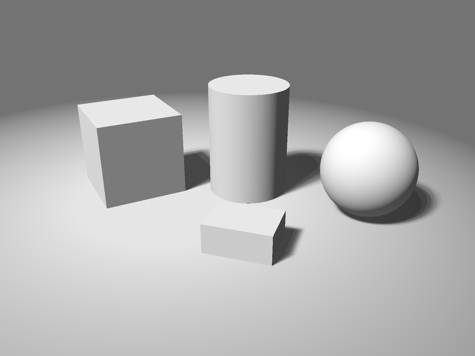
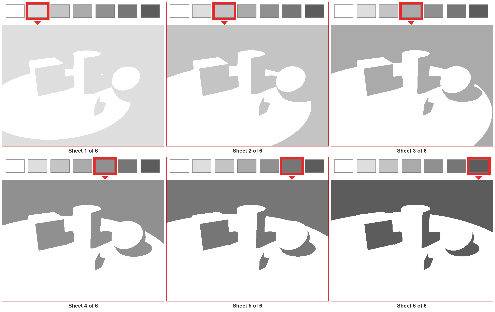
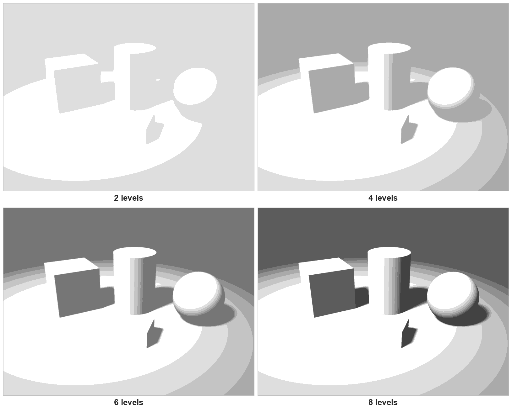
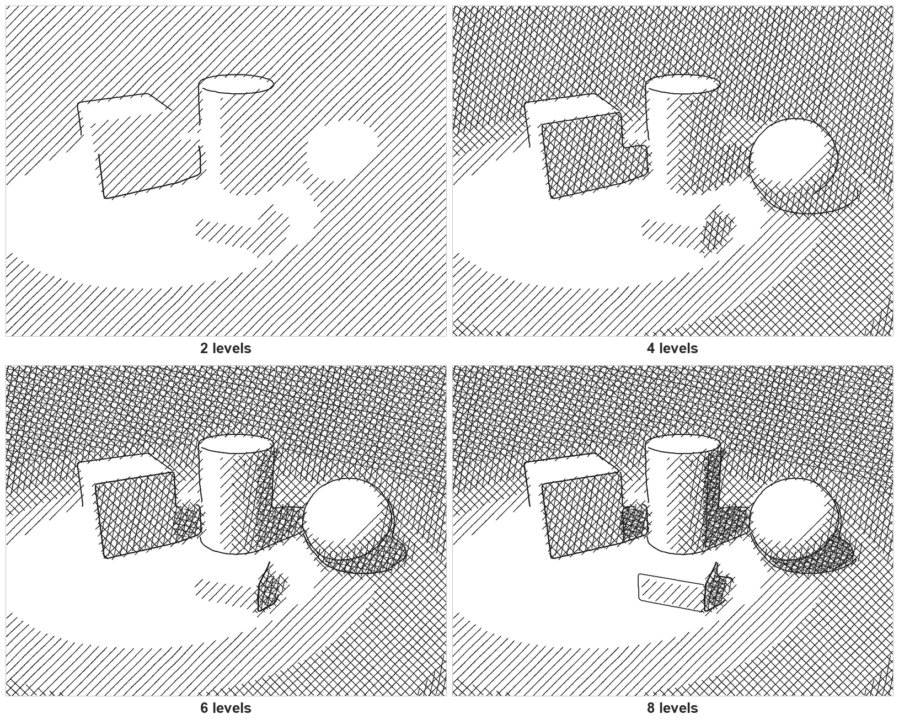
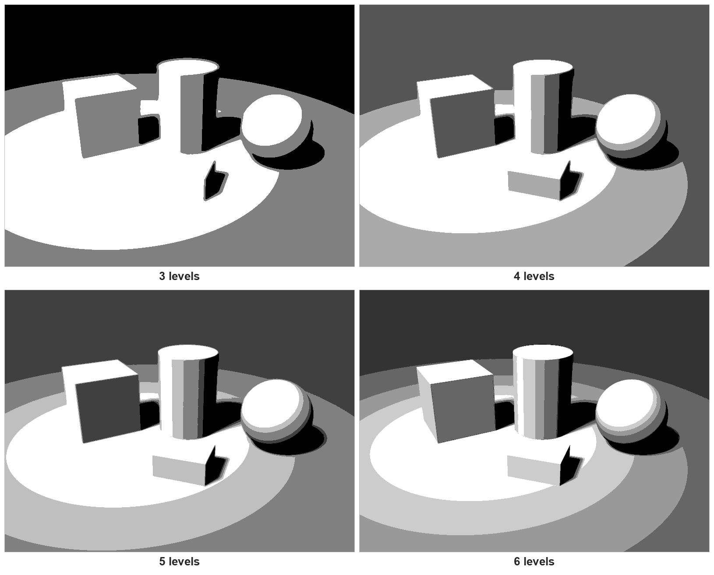
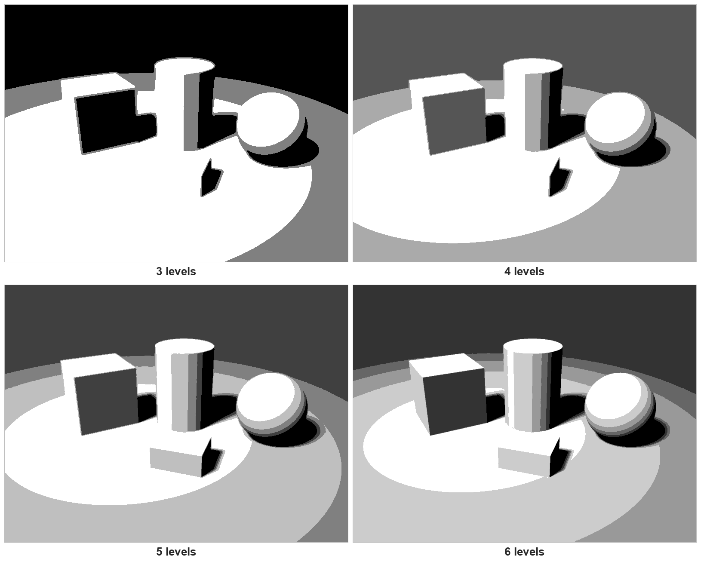
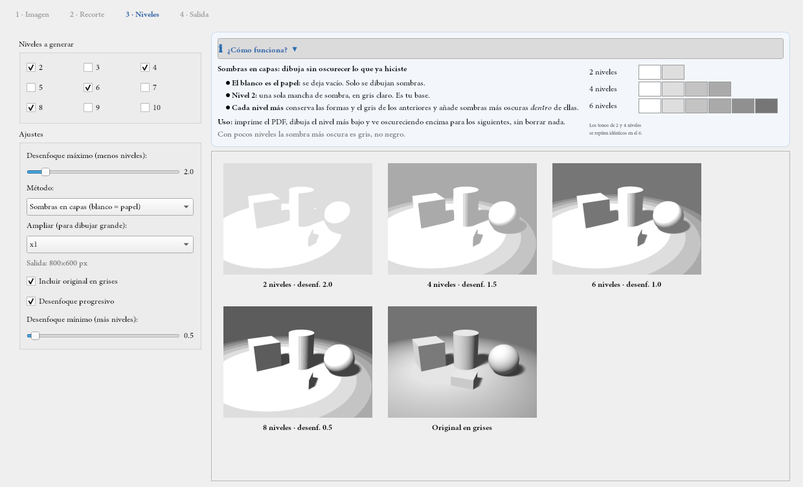

# Posterizer

**Convierte una foto en varias versiones con pocos tonos para estudiar volúmenes y dibujar. Gratis para siempre.**

<!--
  El bloque entre site:start y site:end es la única parte de este README que se
  publica en https://usefulapps.dev/apps/posterizer. Está en inglés porque el sitio
  lo está. Todo lo de fuera (build, desarrollo, notas) se queda en el repo.
  Si borras los marcadores, el build del sitio falla a propósito.
-->

<!-- site:start -->

Posterizer is a **free, offline desktop app that turns a photo into a set of
tonal studies** — the same picture reduced to 2, 3, 4, 5, 6… flat grey values — so
you can learn to see and draw volumes. No upload, no account, no licence key.

## What it does

Drawing volume is mostly about seeing a scene as a few big masses of light and
shadow instead of a thousand details. Posterizer does that squinting for you:
load a photo, crop it, pick how many tonal levels you want, and it renders one
image per level so you can compare a 3-value study with a 6-value one side by side.

- **Crop** the photo with a free or fixed-ratio frame (1:1, 4:3, A4…), and rotate it.
- **Pick the levels** you want (2 to 10) and see a live example of each before exporting.
- **Tune it**: smoothing groups small details into clean masses, and the tone split
  can be balanced by *quantiles* (every level covers a similar area) or *linear*.
- **Layered shadows** mode: white stays as empty paper and only shadows are drawn.
  You choose one number, say 6, and get **6 sheets, one per tone, from lightest to
  darkest**. Each sheet shows what to paint with its tone, and a strip of all the tones
  on top marks the current one in red. Shadows are additive: you paint each sheet over
  the previous one. An in-app panel explains how to use it.
- **Crosshatching** mode: shadows built from strokes. Each extra level (up to 10) adds a
  new stroke direction that crosses the previous ones, only inside the darker zones,
  with the lines getting closer together on deeper layers. Optionally it also draws
  the photo's real edges as clean line work (silhouette, eyelids, nose, mouth), ordered
  by importance: level 2 keeps only the main lines and each level adds finer ones.
  Save it as **vector SVG** and the PDF carries real strokes, sharp at any size.
- **Upscale** up to x4 before posterizing, so edges between masses come out smooth
  and you can print large to draw from.
- **Export** the images to a folder (PNG or JPG), and/or a **PDF** with one level per
  page or all levels on a single sheet — or send it straight to the printer.

## The methods

The same still life (rendered for this page, so no one's photo) through each method,
with the app's default settings. The app lets you pick the levels you want.



### Layered shadows (the default)

White stays as empty paper and only shadows are drawn. The app asks for a single number
of sheets and makes them all: **one sheet per tone, from the lightest grey to the
darkest**. Shadows are additive, so each sheet shows everything that ends up at least that
dark, in that sheet's grey. Paint sheet 1, then sheet 2 over it, and so on: every area
finishes with the tone of the last sheet it appears in. Above each image, a strip shows
the whole range of tones (paper first) with the one to paint on that sheet framed in red.
Because the greys are fixed, a 4-sheet job and a 6-sheet job share their first four sheets.



Two options in this mode: untick *one sheet per tone* to get the classic nested versions
instead (the same shapes at 2, 4, 6 and 8 levels, as below), and *levels adapted to photo
detail* to place the tone cuts where the photo has the most detail (hair in a dark photo,
for instance) instead of at fixed greys.



### Crosshatching

Shadows built from strokes, up to 10 levels. Each level adds a new direction of lines
that crosses the previous ones, only inside the darker zones, and the lines get closer
together on deeper layers. Optional outlines draw the photo's real edges as clean line
work, ordered by importance: level 2 keeps the main lines and each level adds finer
ones. Save it as vector SVG, or print the PDF: the strokes are real vectors.



### Quantiles and Linear

The classic posterize methods. *Quantiles* makes every level cover a similar area;
*Linear* cuts the grey scale into equal steps.





## Workflow

1. Open or drag in a photo (JPG, PNG, WEBP, TIFF, BMP, HEIC).
2. Crop it.
3. Choose the number of sheets (or the levels), smoothing and upscale, checking the previews.
4. Save the images, the PDF, or print.



The app's interface is in Spanish.

Everything runs on your own computer; your photos never leave it.

## The model

- **Free for real.** No trial, no clock, no locked feature.
- **Nothing to sign up for.** If it saved you a bad afternoon, there is a button to
  buy a coffee. That is the whole business model.
- **One reminder.** Every 10 exports a notice appears, makes the joke, and closes
  itself. It never blocks anything.

## Download

Grab the file for your system from the
[latest release](https://github.com/sakur33/DrawingPosterizer/releases/latest):

- **Windows 10 or 11:** `Posterizer.exe`, a single portable file. Download it,
  double-click it, done. Nothing gets installed.
- **macOS (Apple Silicon, M1 or later):** `Posterizer-mac.dmg`. Open it and move
  Posterizer to your Applications folder. Intel Macs are not covered by this build.

<!-- site:end -->

---

## Ejecutar en desarrollo

```bash
pip install -r requirements.txt
python app.py
```

## Estructura

- `app.py` — interfaz (PyQt5): asistente de 4 pasos, exportación y PDF/impresión.
- `cropwidget.py` — widget de recorte (mover, redimensionar, proporción fija).
- `posterizer_core.py` — lógica de posterizado (sin interfaz).
- `hatching.py` — sombreado cruzado: genera los trazos como geometría (sin interfaz).
- `docs/` — imágenes del README (incluida `capas_laminas.png`, el ejemplo de láminas con
  guía de tonos). Se regeneran con `python docs/make_docs.py` (el bodegón se renderiza
  ahí mismo, sin fotos de terceros).
- `make_icon.py` — genera `assets/Posterizer.ico` y `assets/Posterizer.icns`.

## Modo «Sombras en capas»

Tercer método de reparto (`capas` en `posterizer_core.py`). Blanco = papel vacío;
solo hay sombras. Cada profundidad tiene un umbral y un tono **fijos**
(`NESTED_THRESHOLDS` / `NESTED_TONES`), así que subir de nivel no cambia lo ya
existente: solo añade una sombra más oscura dentro de la anterior (n niveles = n-1
sombras, de 2 a 10). La ventana de niveles incluye un panel «¿Cómo funciona?»
(`InfoWidget` en `app.py`) que lo explica al elegir el método.

Por defecto («Una hoja por tono, con guía de tonos») la app pide **un solo número**, k,
y genera k láminas: la lámina j es el nivel j+1 con `only_new=True`, es decir, todo lo
que acaba al menos tan oscuro como la sombra j, en su tono (las sombras son aditivas: se
pinta cada lámina encima de la anterior). `add_tone_guide()` añade encima la tira con
papel + k tonos y marca en rojo el de la lámina; la imagen sale en RGB y algo más alta
(a medida fija, la foto conserva su ancho). Máximo 9 láminas (`NESTED_SHEETS_MAX`).
Desmarcarlo devuelve las casillas de niveles y las versiones anidadas de siempre.
«Niveles adaptados al detalle» (`adaptive_thresholds`) reparte los umbrales según el
gradiente local de la foto en vez de usar los fijos.

## Modo «Sombreado cruzado»

Cuarto método (`trazos`, módulo `hatching.py`). Cada nivel (hasta 10) añade una capa de
trazos en otra dirección dentro de la zona más oscura de la anterior, con las líneas
cada vez más juntas en las capas profundas, y opcionalmente los contornos: los bordes reales
de la foto (silueta, párpados, nariz, boca), detectados como en un dibujo de línea y
ordenados por importancia: el nivel 2 trae las líneas principales y cada nivel añade
otras más finas; las zonas salen
de cuantiles de la propia foto, así que son las mismas en todos los niveles. Los trazos
se generan como **geometría** (polilíneas), no como píxeles: de ahí salen la imagen
(PNG/JPG), el **SVG** vectorial (una capa por nivel, a la medida elegida) y el PDF, que
dibuja los trazos como vectores.

## Cómo se posteriza

recorte → gris → **ampliación (Lanczos)** → desenfoque → autocontraste →
cuantización a N niveles. La ampliación va antes de cuantizar para que los bordes
salgan suaves. El desenfoque se indica en píxeles de la imagen original y se
escala con la ampliación, así el resultado se ve igual a cualquier tamaño.
El lado mayor de la salida se limita a 12 000 px.

## Construir el .exe (Windows)

```bat
build.bat
```

Deja `dist\Posterizer.exe` (onefile, sin consola). Al publicar el release en
GitHub, el nombre del asset debe casar con el `assetPattern` de
`UsefulApps/src/content/apps/posterizer.md`.

## Construir la app de macOS

En un Mac (PyInstaller no compila de forma cruzada), con Python 3.9+ y las Xcode
Command Line Tools:

```bash
./build_mac.sh            # solo compila: dist/Posterizer.app (sin firmar)
./build_mac.sh --sign     # compila + firma + notariza + dist/Posterizer-mac.zip
```

Para `--sign` hace falta la cuenta de desarrollador de Apple:

```bash
export CODESIGN_IDENTITY="Developer ID Application: Tu Nombre (TEAMID)"
export NOTARY_PROFILE="posterizer-notary"
# Una sola vez: guarda las credenciales de notarización en el llavero
xcrun notarytool store-credentials "posterizer-notary"     --apple-id "tu@correo" --team-id "TEAMID" --password "contraseña-de-app"
```

El `.spec` es `Posterizer-mac.spec` (bundle id y versión al principio) y los permisos
del hardened runtime están en `entitlements.plist`. El binario resultante es para la
arquitectura del Mac que compila (Apple Silicon o Intel).

## Configurar la donación

En `app.py`: `DONATE_URL` y `NAG_EVERY` (cada cuántas exportaciones recordar).
